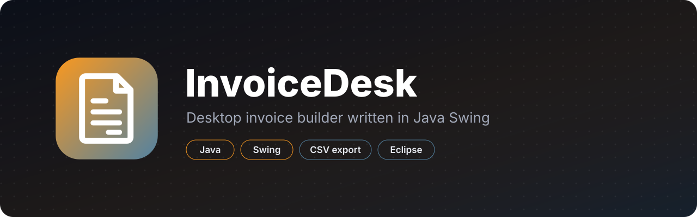
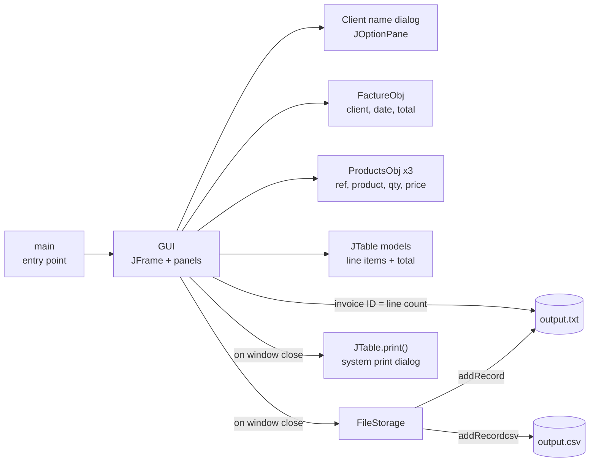

<div align="center">
  
  <p><b>A desktop invoice builder in pure Java Swing: capture a client, add line items, get live totals, then save and print.</b></p>

  <p>
    
    
    
    <a href="LICENSE"></a>
    
    
    
  </p>

  <p><a href="#-quick-start">Quick start</a> · <a href="#-features">Features</a> · <a href="#-architecture">Architecture</a> · <a href="#-contributing">Contributing</a></p>
</div>

## Overview

**InvoiceDesk** is a single-window desktop application that walks an operator through creating a sales invoice: it asks for the client's name, lets them pick products and quantities, computes each line amount and the invoice total in real time, then persists the invoice to flat files and sends the line items to the system print dialog.

It is an academic case study, originally built for the SI coursework in 2021 (repository `java-gui-project-Tp-SI-2021`). The brief asked for an invoice for a parts company with an auto-incrementing invoice number, the current date, three product lines, and automatically calculated line amounts and total. The project is a compact reference for building a form-driven Swing UI with `JTable` models and file-based persistence, with no external dependencies.

## ✨ Features

| Feature | What it does |
| --- | --- |
| **Client capture** | On launch, a modal dialog collects the client's first and last name, which is shown in the invoice header. |
| **Invoice header** | Displays the issuing company, its address, the current date and time, the client's full name and the invoice ID. |
| **Auto-incrementing invoice ID** | The ID is derived from the number of lines in `output.txt`, so every saved invoice gets the next number. |
| **Product line entry** | A product picker, a quantity spinner (1 to 10,000,000) and an **Add Product** button add up to three lines per invoice. |
| **Live line amounts and total** | Each line shows Ref, Product, Unit Price, Quantity and Amount; a separate table shows the running invoice total. |
| **Read-only tables** | Both `JTable`s override `isCellEditable` so totals cannot be edited by hand. |
| **Save on close** | When the window closes, the invoice is appended as one comma-separated record to `output.txt` and `output.csv`. |
| **Print** | After saving, the line-items table is sent to the platform print dialog via `JTable.print()`. |
| **Flat-file storage helpers** | `FileStorage` provides create, append, read, last-ID, update and delete helpers for comma-separated files. |
| **Dark theme** | A consistent dark palette (`#222831` / `#393e46`) with white text across panels and tables. |

## 🧱 Tech stack

| Layer | Technology |
| --- | --- |
| Language | Java (standard library only, no third-party dependencies) |
| UI | Swing (`JFrame`, `JSplitPane`, `JTable`, `JComboBox`, `JSpinner`, `JOptionPane`) |
| Data model | Plain Java objects (`FactureObj`, `ProductsObj`) |
| Persistence | Comma-separated flat files (`output.txt`, `output.csv`) via `java.io` |
| Printing | `JTable.print()` (Java printing API) |
| Tooling | Eclipse project files (`.project`, `.classpath`), or plain `javac` / `java` |

## 🏗 Architecture



```text
src/
├── main.java          # entry point, creates the GUI
├── GUI.java           # window layout, event handling, totals, save and print
├── FactureObj.java    # invoice model (ID, client name, date, total)
├── ProductsObj.java   # invoice line model (ref, product, quantity, unit price)
└── FileStorage.java   # comma-separated flat-file read/write helpers
```

## 🚀 Quick start

### Prerequisites

- A JDK, version 8 or later (verified with JDK 21)
- A desktop session (Swing needs a display), and optionally a printer or "print to PDF" target

### Clone

```bash
git clone https://github.com/ismailbentabett/java-gui-project-Tp-SI-2021.git
cd java-gui-project-Tp-SI-2021
```

### Build and run from the command line

Run these from the repository root, because the app reads and writes `output.txt` and `output.csv` in the working directory. `GUI.java` is saved in Windows-1252 encoding, so pass `-encoding windows-1252` to `javac`.

```bash
javac -encoding windows-1252 -d bin src/*.java
java -cp bin main
```

`bin/` is already listed in `.gitignore`.

### Run from Eclipse

1. **File > Import > General > Existing Projects into Workspace**, then select the cloned folder.
2. Set the project's text file encoding to `windows-1252` (**Project > Properties > Resource**) if Eclipse reports an encoding error.
3. Right-click `src/main.java` and choose **Run As > Java Application**.

### Using the app

1. Enter the client's first and last name and press **OK**.
2. Pick a product, set the quantity and press **Add Product** (up to three lines).
3. Close the window to save the invoice to `output.txt` / `output.csv` and open the print dialog.

## ⚙️ Configuration

InvoiceDesk has no environment variables or configuration files. Behaviour is defined in code:

| Setting | Where | Current value |
| --- | --- | --- |
| Product catalogue | `GUI.java`, `products` array | `dell`, `hp`, `samsung` |
| Unit prices | `GUI.java`, assigned per line slot | 200,000 / 350,000 / 750,000 |
| Lines per invoice | `GUI.java`, `productChecker` | 3 |
| Data files | Working directory | `output.txt`, `output.csv` |

`output.txt` must exist before launch, since the invoice ID is computed from its line count. The repository ships a seeded copy with a header row.

## 📁 Project structure

```text
java-gui-project-Tp-SI-2021/
├── .github/            # issue/PR templates and branding assets
├── src/                # Java sources (default package)
├── output.txt          # invoice records, also the source of the next invoice ID
├── output.csv          # same records in a spreadsheet-friendly file
├── .project            # Eclipse project descriptor
├── .classpath          # Eclipse build path
└── README.md
```

## 🗺 Roadmap

- [x] Client capture, line entry, live totals
- [x] Save invoices to text and CSV files
- [x] Print the line-items table
- [ ] Load product names and prices from a data file instead of per-slot prices
- [ ] Support a variable number of lines per invoice
- [ ] Validate the client dialog (handle Cancel and empty names)
- [ ] Align the CSV columns for the third product line
- [ ] Add an explicit **Save and print** button and exit cleanly on close
- [ ] Convert source files to UTF-8 and add a Maven or Gradle build
- [ ] Add unit tests for `FileStorage` and the totals logic

## 🤝 Contributing

Contributions are welcome. Read [CONTRIBUTING.md](CONTRIBUTING.md) for the workflow, and follow the [Code of Conduct](CODE_OF_CONDUCT.md).

## 🔒 Security

Please report vulnerabilities privately as described in [SECURITY.md](SECURITY.md).

## 📄 License

Released under the [MIT License](LICENSE).

---

<div align="center">
  <p>Built by <b>Ismail Bentabett</b> · <a href="https://github.com/ismailbentabett">GitHub</a> · <a href="https://ismailbentabett.com">ismailbentabett.com</a></p>
  <p>⭐ Star this repo if you find it useful</p>
</div>
